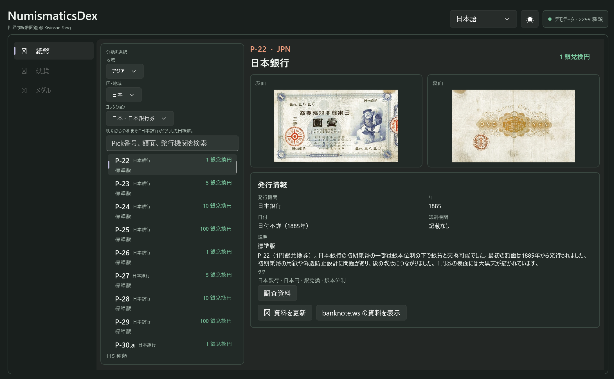

# NumismaticsDex

[](https://github.com/KKtheGhost/NumismaticsDex/actions/workflows/ci.yml)
[](https://github.com/KKtheGhost/NumismaticsDex/actions/workflows/release.yml)

<!-- coverage:start -->

[](https://github.com/KKtheGhost/NumismaticsDex/actions/workflows/ci.yml)
<!-- coverage:end -->

NumismaticsDex is a Windows-native numismatic catalog demo for exploring banknotes by region, country, collection, and Pick variant.



## Requirements

- Windows 10 version 1809 or later
- .NET 8 SDK
- Internet access to restore the Windows App SDK packages and load images for the selected banknote; source metadata refresh remains explicit
- For MSIX creation and local installation: Windows SDK packaging tools and a trusted signing certificate

The app uses WinUI 3 with Windows App SDK 2.5.1. The Windows SDK targeting reference is pinned in the app project so the required reference pack can be restored through NuGet.

## Build and run

```powershell
dotnet restore .\NumismaticsDex.sln
dotnet build .\NumismaticsDex.sln -c Debug
```

Run the packaged app from Visual Studio 2022 (17.11 or later) with the Windows App SDK and MSIX tooling installed. The startup window opens at a desktop-friendly size.

The subtitle credits Kivinsae Fang in Simplified Chinese, Traditional Chinese, and English. The header language selector supports English, Simplified Chinese, Traditional Chinese, and Japanese. Japanese is used for translated interface and catalog values; source text is retained where a reliable translation is unavailable. The sun/moon icon toggles both the page palette and native WinUI control theme. Catalog metadata loads at launch; only the selected banknote's front and back images are fetched as needed and cached on disk. The image directory is not included in Git or the default release package.

Browse the catalog through a cascading region, country, and collection selector. New collections can be added without listing every issue in this overview.

## Tests and coverage

Run the unit suite locally:

```powershell
dotnet test .\NumismaticsDex.Tests\NumismaticsDex.Tests.csproj -c Release
```

GitHub Actions builds the WinUI app, runs tests, and collects line coverage for Core and non-UI catalog, localization, and image/source logic. The WinUI view is build-checked but excluded from unit line coverage. The CI badge above reflects the latest workflow result; after pushes to `main`, CI updates the coverage percentage and source commit shown here.

## Releases

Pushing a `v0.0.1` tag or manually running the Release workflow with that tag publishes a signed GitHub prerelease with the MSIX, its Windows App Runtime dependencies, and the signing certificate. The package uses a temporary self-signed demo certificate; trust it only if you accept that certificate, and do not treat it as a production publisher identity.

## Create an MSIX

Create and trust a current-user development signing certificate once:

```powershell
\.\scripts\New-DevCertificate.ps1
```

The first script keeps the private key in `CurrentUser\My` and trusts it for the current user. AppX deployment also requires the self-signed root to be trusted on the device. Run the following once from an elevated PowerShell window; it imports only this app's public certificate into the machine `Root` and `TrustedPeople` stores:

```powershell
\.\scripts\Trust-DevCertificate-Machine.ps1
```

This does not disable signature checks. The install script checks for machine trust and explains this prerequisite if it is missing. To remove the machine trust later, run `\.\scripts\Trust-DevCertificate-Machine.ps1 -Remove` from an elevated PowerShell window.

Build, install/update, and launch the signed package:

```powershell
.\scripts\Package.ps1
.\scripts\Install-Dev.ps1
.\scripts\Run-Installed.ps1
```

## Catalog data and sources

The catalog is stored in `NumismaticsDex.App\Assets\catalog.json`. To add a collection, use the importer with that source category's URL and collection metadata; it replaces only the selected collection and preserves the rest of the catalog:

```powershell
.\scripts\Import-BanknoteCollection.ps1
```

Pass `-CategoryUrl`, `-CollectionId`, `-CollectionTitle`, and `-CollectionDescription` for another category. Research refresh scripts are available under `scripts/` for collections with maintained notes.

The importer can keep full-size source images in the local `Assets\Banknotes` directory. That directory is ignored by Git and excluded from default builds and releases. At runtime, only the selected note's front and back images are fetched, streamed to the per-user cache, and decoded at a bounded width. Use `Package.ps1 -IncludeLocalBanknoteAssets` only for a licensed private/offline package.

Source detail links are retained with catalog records, and research notes link to their references. Catalog data and image URLs are attributed to [banknote.ws](http://www.banknote.ws/); research also draws on Wikipedia and other public historical references. The source website retains rights to its images, so confirm permission before redistributing scans.

## Architecture

- `NumismaticsDex.Core`: portable catalog types and data contracts. `CatalogItem` is category-neutral; `Banknote` adds country/Pick/subnumber identity. Coin and medal models can be added without changing the UI's shared identity contract.
- `NumismaticsDex.App`: WinUI 3 desktop interface, search, selection, localized banknote details, and light/dark themes.
- `scripts`: full-category import, development certificate setup, MSIX packaging, install/update, uninstall, launch, and manifest icon generation.

The Core library targets .NET 8 and is separate from WinUI so future iOS and Linux clients can reuse catalog data types with platform-appropriate frontends.